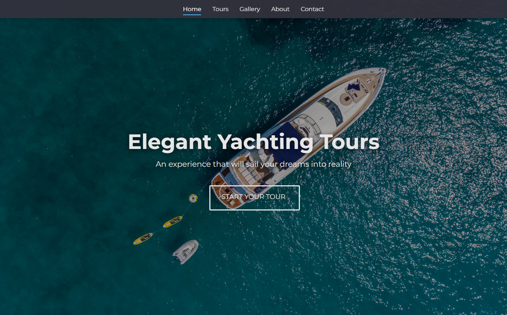
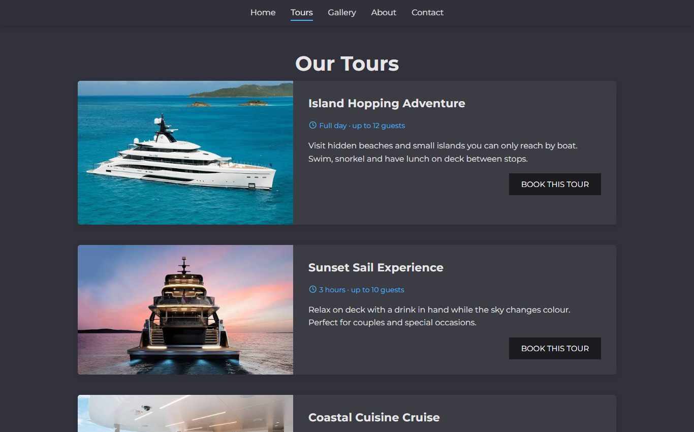
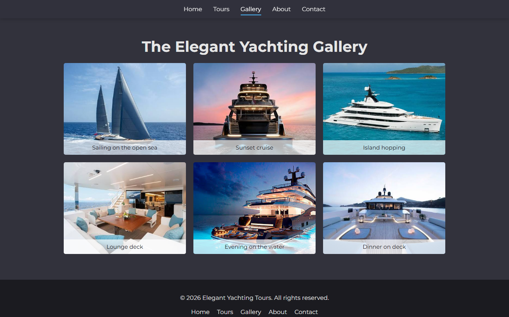

# Elegant Yachting Tours

A multi-page website for a fictional yacht tour company, built with plain HTML, CSS and a little JavaScript.

**Live demo:** https://meltemglsn.github.io/elegant-yachting-tours/

## Pages

- **Home** - full-screen hero image and a short overview of the tours
- **Tours** - three tour cards with duration, group size and a booking link
- **Gallery** - responsive photo grid with captions and a hover zoom
- **About** - two-column layout with a call-to-action section
- **Contact** - booking form (name, email, tour, guests, date, message) and contact details

| Tours | Gallery |
|---|---|
|  |  |

## What I practised

- Semantic HTML (`header`, `main`, `section`, `article`, `figure`, `footer`)
- Flexbox and CSS Grid layouts
- Responsive design with media queries (desktop, tablet and mobile)
- CSS transitions and pseudo-elements for the animated outline button
- Accessible forms with labels, and `aria-current` for the active page in the menu
- A small JavaScript handler that shows a confirmation message when the form is sent

## Run it locally

No build step needed. Clone the repo and open `index.html` in your browser.

## Credits

Fonts from Google Fonts (Montserrat), icons from Font Awesome. Photos are used for learning purposes only.
